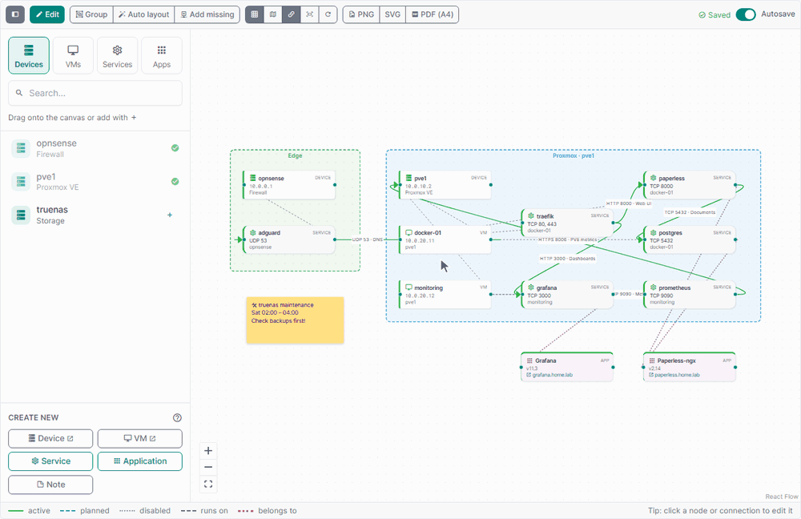
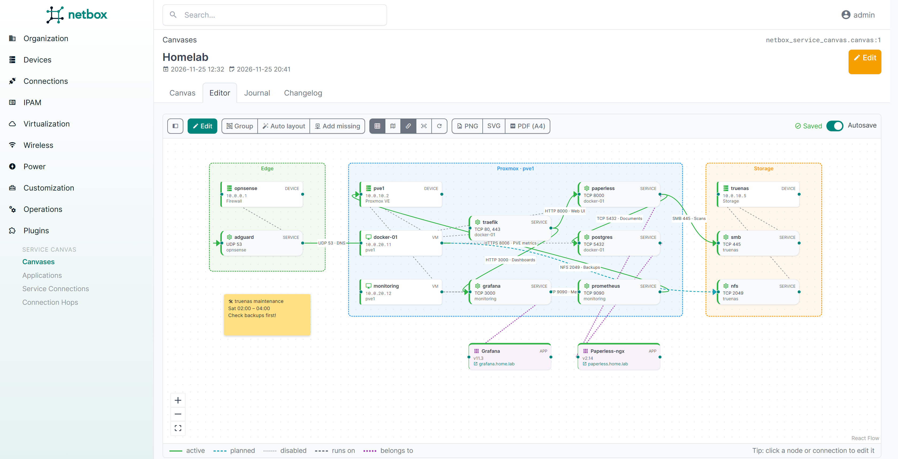
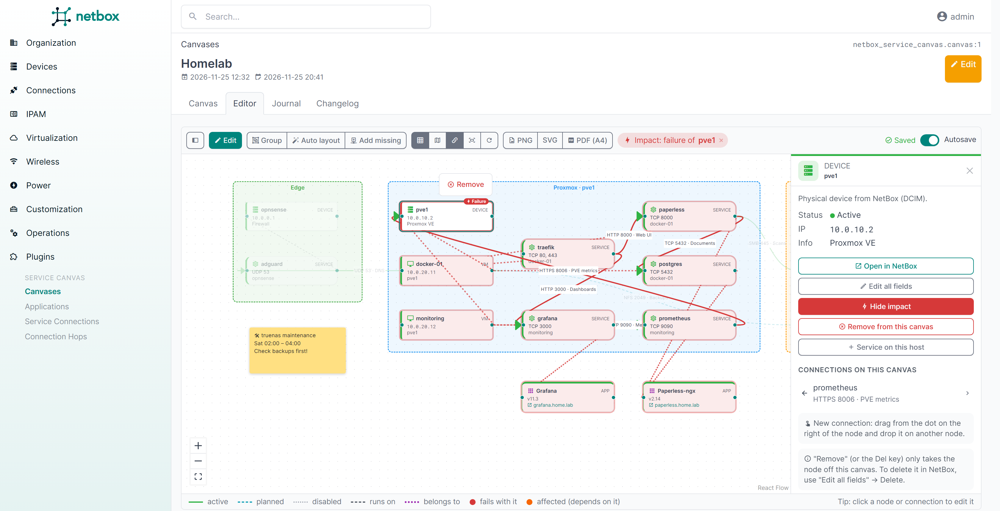
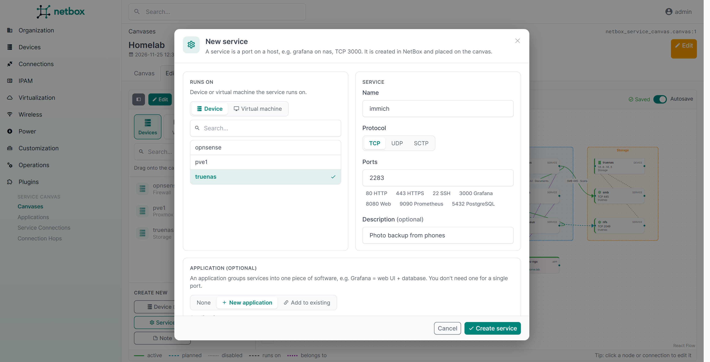

<div align="center">

# 🗺️ NetBox Service Canvas

**See which services run where and how they talk to each other, right inside NetBox.**

An interactive, drag-and-drop canvas for [NetBox](https://github.com/netbox-community/netbox) that turns your
devices, VMs, services and applications into a living architecture diagram. The diagram is built from real
NetBox data, not just drawn.

[](https://github.com/netbox-community/netbox)
[](https://www.python.org/)
[](https://react.dev/)
[](https://pypi.org/project/netbox-service-canvas/)
[](https://github.com/Jasper-Claus/netbox-service-canvas/blob/main/LICENSE)
[](#-built-100-with-ai)
[](https://github.com/Jasper-Claus/netbox-service-canvas/actions/workflows/ci.yml)

[Features](#-features) · [Install](#-installation) · [How it works](#-how-it-works) · [Permissions](#-permissions) ·
[API](#-rest-api--graphql) · [📖 Wiki](https://github.com/Jasper-Claus/netbox-service-canvas/wiki) ·
[🇩🇪 Deutsch](https://github.com/Jasper-Claus/netbox-service-canvas/blob/main/docs/README.de.md)

</div>

<p align="center">
  
  <br><sub>Drag a host in, let <i>Add missing</i> pull in its services, draw a connection, then ask what breaks if it fails.</sub>
</p>

---

## 💙 Why this exists

I love NetBox. It's the source of truth for everything in my homelab: racks, devices, VMs, IPs, VLANs. But one
question it never answered at a glance was:

> *"Which service runs on which box, and who talks to whom over which port?"*

The topology plugins show cables and links. I wanted the **service layer**: Grafana pulling metrics from Prometheus,
Paperless writing to Postgres on the NAS, the reverse proxy in front of everything. So I built this plugin, and I
hope it's useful to you too. ✨

## 🤖 Built 100% with AI

Full transparency: **every line of this plugin was written by AI.** That includes the Django models, the REST and
GraphQL API, the React editor, the tests and this README. It was created with [Claude](https://claude.ai) (Anthropic)
through *Claude Code*, with me as the product owner. I described what I wanted, tested it in my homelab and gave
feedback.

It was an experiment in how far you can get when a NetBox fan with ideas teams up with an AI pair programmer. The
answer: pretty far. Issues, ideas and PRs from humans (or their AIs 😄) are very welcome.

---

## ✨ Features

### 🧩 Data model (usable everywhere in NetBox, even without a canvas)

| Object | What it is |
|---|---|
| **Service** *(NetBox core)* | A port/protocol on exactly one device or VM, e.g. `grafana, TCP 3000 on nas`. |
| **Application** *(new)* | The software as a whole, made of one or more services, e.g. **Grafana** = web UI service + database service. Has status, version and URL. |
| **Service Connection** *(new)* | "A talks to B": source/target can be a service, device, VM or application. Includes direction, protocol, port, *data* description and status. |
| **Connection Hop** *(new)* | Ordered waypoints of a connection: reverse proxy, VRF, VLAN, tunnel, prefix, IP… |

- Full NetBox integration: list views, filters, CSV import, bulk edit, global search, REST API, GraphQL, change log
  and journal.
- **Connections** tab (dependency table) on device, VM, service and application pages.
- **Applications** panel on service, device and VM pages.
- **Show on canvas** button that jumps straight into the editor and highlights the object.

### 🎨 Canvas editor

- 🖱️ **Drag & drop** devices, VMs, services and applications from a searchable sidebar.
- 🔗 **Draw an edge to create real data.** A *data flow* creates a `ServiceConnection`, and *runs on* sets the
  service's host.
- 🪟 **Node panel** (click any node): details, its connections, quick edit for services and applications, a link to
  the full NetBox form (with a jump back to the editor) and *remove from canvas*.
- ⚡ **Impact analysis**: "What breaks if this box goes down?" Red marks what fails with it (a hypervisor takes its
  VMs, their services and applications down with it), orange marks everything that depends on it (transitively).
- 📝 **Sticky notes** for maintenance windows, TODOs and explanations.
- 🗂️ **Groups** (racks, clusters, VLANs…) with name, colour and resizing.
- 🪄 **Auto layout** (ELK), *add missing* (pulls in related hosts, services and peers), minimap, snap to grid.
- 💾 **Autosave**: only what actually changed is written, so your change log isn't flooded.
- 🖨️ **Export** as PNG, SVG or a **print-ready DIN A4 PDF** with header and legend.
- 🌗 Follows the NetBox **light/dark theme**. **Read-only mode** respects NetBox permissions, including object
  constraints.
- 🔒 **No CDNs, no external calls.** The frontend is bundled with the plugin.

### 🧭 Service vs. Application (in one sentence each)

- **Service** = *where* something listens: one port on one host (`grafana · TCP 3000 · nas`).
- **Application** = *what* it is: the software, optionally spanning several services and hosts (`Grafana`).

For a simple one-port app you only need a service. When you create a service in the editor, you can create or link
the application in the same dialog.

### 📸 Screenshots

<p align="center">
  
</p>

<table>
  <tr>
    <td width="50%"></td>
    <td width="50%"></td>
  </tr>
  <tr>
    <td align="center">⚡ <b>Impact analysis</b>: what breaks if <code>truenas</code> goes down?</td>
    <td align="center">➕ <b>New service</b> with an optional application, in one dialog</td>
  </tr>
</table>

> The editor follows your NetBox language: English by default, German if NetBox is set to German.
> Screenshots show a demo homelab, not real infrastructure.

---

## 📦 Installation

Requirements: NetBox 4.5.x (tested with 4.5.7) and Python 3.12+.

> [!WARNING]
> The plugin declares support for NetBox 4.5 only. On a newer minor version (e.g. 4.6) NetBox refuses to start
> while the plugin is enabled. Before upgrading NetBox, check for a matching plugin release, or remove
> `netbox_service_canvas` from `PLUGINS` first.

### netbox-docker

All files below are in your netbox-docker folder (next to `docker-compose.yml`). New to plugins in netbox-docker?
Create `plugin_requirements.txt`, `Dockerfile-Plugins` and `docker-compose.override.yml` first, as described in
[Using NetBox Plugins](https://github.com/netbox-community/netbox-docker/wiki/Using-Netbox-Plugins).

1. Open `plugin_requirements.txt` (e.g. `nano plugin_requirements.txt`) and add this line. It goes into the file,
   not into the terminal:

   ```text
   netbox-service-canvas
   ```

2. Open `Dockerfile-Plugins` and make sure it ends with this line. It copies the editor's JavaScript and CSS into
   NetBox while the image is built:

   ```dockerfile
   RUN DEBUG="true" SECRET_KEY="dummydummydummydummydummydummydummydummydummydummy"        /opt/netbox/venv/bin/python /opt/netbox/netbox/manage.py collectstatic --no-input
   ```

3. Open `configuration/plugins.py` and add `"netbox_service_canvas"` to your existing `PLUGINS` list. Do not
   replace the list. If you use netbox-branching, `netbox_branching` must stay last:

   ```python
   PLUGINS = [
       # ... your other plugins ...
       "netbox_service_canvas",
   ]
   ```

4. Rebuild and restart. Database migrations run automatically when the container starts:

   ```bash
   docker compose build --no-cache
   docker compose up -d
   ```

5. Check: the menu shows *Plugins → Service Canvas*. Create a canvas and open its *Editor* tab. If the editor stays
   at "Loading canvas…", the collectstatic line from step 2 is missing (see the troubleshooting section of the
   guide below).

### Plain install (without Docker)

```bash
source /opt/netbox/venv/bin/activate
pip install netbox-service-canvas
echo netbox-service-canvas >> /opt/netbox/local_requirements.txt   # keeps it across NetBox upgrades
```

Add `"netbox_service_canvas"` to the existing `PLUGINS` list in `/opt/netbox/netbox/netbox/configuration.py`, then:

```bash
cd /opt/netbox/netbox
python manage.py migrate
python manage.py collectstatic --no-input
sudo systemctl restart netbox netbox-rq
```

Optional settings (`PLUGINS_CONFIG`): `grid_size` (default `10`), the grid in pixels.

📖 Step-by-step guide with backup, update and uninstall (German):
[docs/install-netbox-docker.md](https://github.com/Jasper-Claus/netbox-service-canvas/blob/main/docs/install-netbox-docker.md) ·
🧪 Dev/test environment on a VM or LXC: [dev/README.md](https://github.com/Jasper-Claus/netbox-service-canvas/blob/main/dev/README.md)

---

## 🚀 How it works

1. **Plugins → Service Canvas → Canvases → Add**, give it a name (e.g. *Homelab*).
2. Open the **Editor** tab.
3. Drag your devices and VMs onto the canvas, then click **Add missing** to pull in their services.
4. Drag from the dot on the right of a node to another node to create a **data flow**.
5. Click a node or an edge to edit it. Use ⚡ **Impact analysis** to see what depends on it.
6. Export the result as a **PDF (A4)** for your documentation folder. 🖨️

**Design principle:** relationships are real NetBox data; the canvas only stores the layout. The same object can
appear on many canvases, and if it is deleted in NetBox it disappears from every canvas. The plugin is compatible
with [netbox-branching](https://github.com/netboxlabs/netbox-branching): all models are change-logged and there is
no raw SQL.

---

## 🔐 Permissions

| Action | Required permission |
|---|---|
| View a canvas | `view` on *canvas* (objects and connections only as far as you may view them) |
| Move, add, remove nodes | `change` on the canvas + `add/change/delete` on *canvas node* |
| Groups / notes | additionally `add/change/delete` on *canvas group* / *canvas note* |
| Create / edit / delete data flows | `add/change/delete` on *service connection* |
| Hops | `add/change/delete` on *connection hop* |
| New service, "runs on", quick edit | `add` / `change` on *ipam › service* |
| Applications | `add` / `change` on *application* |

---

## 🔌 REST API & GraphQL

Base URL: `/api/plugins/service-canvas/`

| Endpoint | |
|---|---|
| `applications/`, `connections/`, `connection-hops/`, `canvases/`, `canvas-groups/`, `canvas-nodes/`, `canvas-notes/` | Standard NetBox CRUD, bulk, filters, brief mode |
| `GET canvases/<id>/graph/` | Everything the editor needs in one request |
| `GET canvases/<id>/missing/` | Related objects not yet on the canvas |
| `GET/PUT canvases/<id>/layout/` | Read / atomically save the layout (diff only) |
| `POST connections/<id>/reorder-hops/` | Reorder hops in one transaction |

GraphQL: `service_canvas_application(_list)`, `service_canvas_connection(_list)`, `service_canvas_canvas(_list)`
and more.

---

## 🛠️ Development

```bash
# Frontend (React 18 + React Flow 12 + Vite), output goes to netbox_service_canvas/static/…/dist
cd frontend && npm ci && npm test && npm run build

# Backend tests run inside a NetBox dev environment, see dev/README.md
python manage.py test netbox_service_canvas
```

See [CONTRIBUTING.md](https://github.com/Jasper-Claus/netbox-service-canvas/blob/main/CONTRIBUTING.md) for details.

## 🗺️ Roadmap ideas

- [ ] Auto-fill groups from cluster / site / tag
- [ ] Services drawn inside their host's container
- [ ] Filters and search on the canvas, undo/redo
- [ ] More UI languages (one dictionary file each, PRs welcome)

Got an idea? [Open an issue](https://github.com/Jasper-Claus/netbox-service-canvas/issues/new/choose). ⭐ Stars
are appreciated if you find this useful!

## 📄 License

[Apache-2.0](https://github.com/Jasper-Claus/netbox-service-canvas/blob/main/LICENSE). Not affiliated with NetBox Labs. NetBox is a trademark of NetBox Labs, Inc.

---

<div align="center">

Made with 💙 for the NetBox community: an idea from a homelabber, code by AI.

`#NetBox` `#NetBoxPlugin` `#Homelab` `#SelfHosted` `#SourceOfTruth` `#IPAM` `#DCIM` `#NetDevOps`
`#NetworkAutomation` `#InfrastructureDocumentation` `#ServiceMap` `#DependencyMapping` `#ImpactAnalysis`
`#SysAdmin` `#DevOps` `#Django` `#React` `#ReactFlow` `#OpenSource` `#BuiltWithAI` `#ClaudeCode` `#AIAssisted`

</div>
