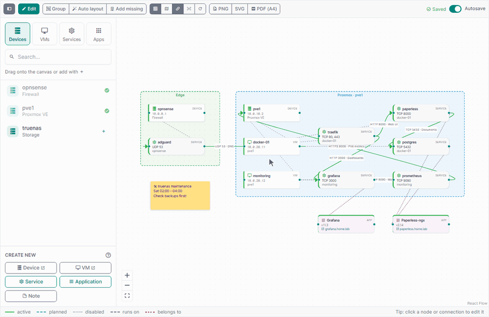
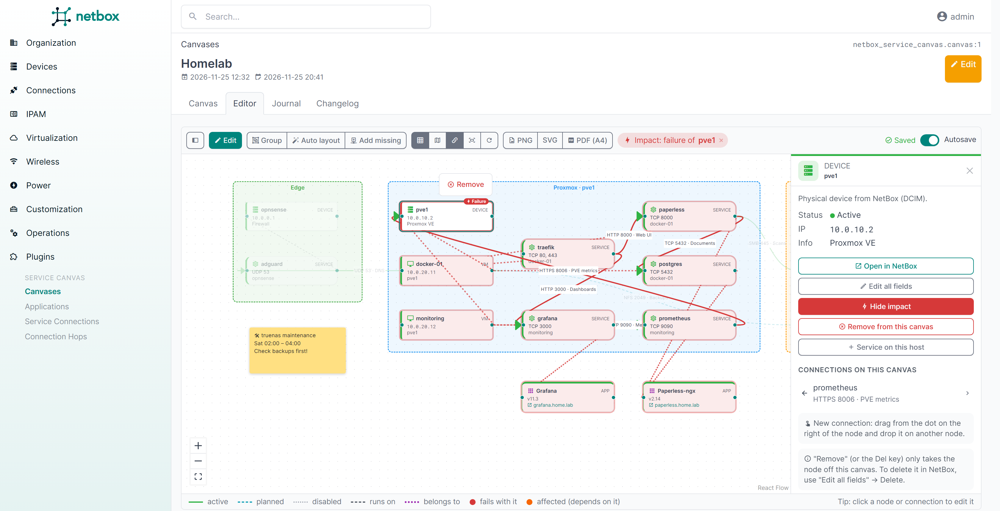
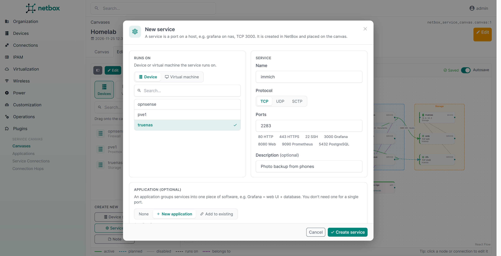

# 🗺️ NetBox Service Canvas

Ein NetBox-Plugin, das auf einer interaktiven Arbeitsfläche zeigt, welche Services wo laufen, wie sie miteinander
kommunizieren und was ausfällt, wenn ein Host ausfällt.

English version: [README.md](../README.md)

[Installation](#installation) · [So funktioniert es](#so-funktioniert-es) · [Funktionen](#funktionen) ·
[Berechtigungen](#berechtigungen) · [Wiki](https://github.com/Jasper-Claus/netbox-service-canvas/wiki)



<sub>Host hineinziehen, mit <i>Fehlende ergänzen</i> seine Services holen, eine Verbindung ziehen und prüfen, was bei
einem Ausfall betroffen ist.</sub>

---

## Installation

Voraussetzungen: NetBox 4.5.x und Python 3.12 oder neuer.

> [!WARNING]
> Das Plugin erklärt sich nur mit NetBox 4.5 kompatibel. Auf einer neueren Minor-Version (zum Beispiel 4.6) startet
> NetBox insgesamt nicht, solange das Plugin aktiviert ist. Vor einem NetBox-Upgrade unter
> [Releases](https://github.com/Jasper-Claus/netbox-service-canvas/releases) nach einer passenden Plugin-Version
> sehen oder `netbox_service_canvas` vorher aus `PLUGINS` entfernen.

### netbox-docker

Alle Dateien liegen im netbox-docker-Ordner, neben `docker-compose.yml`. Wer dort noch nie ein Plugin installiert
hat, liest zuerst [Noch keine Plugins installiert?](#noch-keine-plugins-installiert).

1. `plugin_requirements.txt` öffnen (zum Beispiel mit `nano plugin_requirements.txt`) und diese Zeile ergänzen. Sie
   gehört in die Datei, nicht ins Terminal:

   ```text
   netbox-service-canvas
   ```

2. `Dockerfile-Plugins` öffnen und sicherstellen, dass die Datei mit dieser Zeile endet. Sie kopiert JavaScript und
   CSS des Editors beim Bauen des Images nach NetBox:

   ```dockerfile
   RUN DEBUG="true" SECRET_KEY="dummydummydummydummydummydummydummydummydummydummy" /opt/netbox/venv/bin/python /opt/netbox/netbox/manage.py collectstatic --no-input
   ```

3. `configuration/plugins.py` öffnen und `"netbox_service_canvas"` in die bestehende `PLUGINS`-Liste eintragen. Den
   Eintrag ergänzen, die Liste nicht ersetzen. Wer netbox-branching nutzt: `netbox_branching` bleibt der letzte
   Eintrag.

   ```python
   PLUGINS = [
       # ... deine anderen Plugins ...
       "netbox_service_canvas",
   ]
   ```

4. Image neu bauen und starten. Die Datenbank-Migrationen laufen beim Start des Containers automatisch:

   ```bash
   docker compose build --no-cache
   docker compose up -d
   ```

5. Prüfen: Im Menü erscheint *Plugins → Service Canvas*. Eine Canvas anlegen und den Tab *Editor* öffnen. Bleibt der
   Editor bei „Lade Canvas…“ stehen, siehe [Fehlersuche](#fehlersuche).

#### Noch keine Plugins installiert?

netbox-docker braucht drei Dateien, um Plugins zu installieren. Die offizielle Anleitung ist
[Using NetBox Plugins](https://github.com/netbox-community/netbox-docker/wiki/Using-Netbox-Plugins). Nur für dieses
Plugin sehen die Dateien so aus:

`plugin_requirements.txt`

```text
netbox-service-canvas
```

`Dockerfile-Plugins` (dasselbe Image-Tag wie in deiner `docker-compose.yml` verwenden)

```dockerfile
FROM netboxcommunity/netbox:v4.5

COPY ./plugin_requirements.txt /opt/netbox/
RUN /usr/local/bin/uv pip install -r /opt/netbox/plugin_requirements.txt

RUN DEBUG="true" SECRET_KEY="dummydummydummydummydummydummydummydummydummydummy" /opt/netbox/venv/bin/python /opt/netbox/netbox/manage.py collectstatic --no-input
```

`docker-compose.override.yml` (gibt es die Datei schon, die Zeilen `image`, `pull_policy` und `build` ergänzen und
die übrigen Einstellungen behalten, zum Beispiel `ports`)

```yaml
services:
  netbox:
    image: netbox:latest-plugins
    pull_policy: never
    build:
      context: .
      dockerfile: Dockerfile-Plugins
  netbox-worker:
    image: netbox:latest-plugins
    pull_policy: never
```

Danach mit Schritt 3 oben weitermachen.

### Klassische Installation (ohne Docker)

Die Befehle als der Benutzer ausführen, dem die NetBox-Installation gehört (meist mit `sudo`):

```bash
source /opt/netbox/venv/bin/activate
pip install netbox-service-canvas
echo netbox-service-canvas >> /opt/netbox/local_requirements.txt   # Plugin bleibt bei NetBox-Upgrades erhalten
```

`/opt/netbox/netbox/netbox/configuration.py` öffnen und `"netbox_service_canvas"` in die bestehende `PLUGINS`-Liste
eintragen. Dann:

```bash
cd /opt/netbox/netbox
python manage.py migrate
python manage.py collectstatic --no-input
sudo systemctl restart netbox netbox-rq
```

Prüfen wie in Schritt 5 oben.

### Konfiguration (optional)

Das Plugin funktioniert ohne Einstellungen. Wer ein anderes Raster möchte, ergänzt in `PLUGINS_CONFIG` (neben den
bestehenden Einträgen):

```python
PLUGINS_CONFIG = {
    "netbox_service_canvas": {
        "grid_size": 10,   # Raster in Pixeln, Standard 10
    },
}
```

### Update

Vorher ein Datenbank-Backup machen. Bei netbox-docker `docker compose build --no-cache` und `docker compose up -d`
erneut ausführen; das installiert das neueste Release (oder die in `plugin_requirements.txt` festgelegte Version).
Bei der klassischen Installation `pip install --upgrade netbox-service-canvas` ausführen und `migrate`,
`collectstatic` und den Neustart wiederholen. Danach den Editor einmal mit Strg+F5 neu laden.

### Deinstallation

> [!CAUTION]
> Der erste Schritt löscht alle Canvases, Verbindungen, Hops und Applications dieses Plugins. Vorher ein
> Datenbank-Backup machen. Devices, VMs und Services in NetBox bleiben unangetastet.

1. Die Tabellen des Plugins entfernen, solange das Plugin noch installiert ist:
   `docker compose exec netbox /opt/netbox/netbox/manage.py migrate netbox_service_canvas zero`
   (klassisch: `python manage.py migrate netbox_service_canvas zero`).
2. `netbox_service_canvas` aus `PLUGINS` und `PLUGINS_CONFIG` entfernen, außerdem die Zeile aus
   `plugin_requirements.txt` bzw. `local_requirements.txt`.
3. Neu bauen und starten (netbox-docker) bzw. `pip uninstall netbox-service-canvas` und neu starten (klassisch).
4. Optional die übrig gebliebenen Static-Dateien löschen. In netbox-docker geht das nur als root:
   `docker compose exec -u root netbox rm -rf /opt/netbox/netbox/static/netbox_service_canvas`

Eine ausführliche Anleitung mit Backup und Wiederherstellung steht in
[install-netbox-docker.md](install-netbox-docker.md).

### Fehlersuche

| Symptom | Ursache und Lösung |
|---|---|
| Der Editor bleibt bei „Lade Canvas…“ stehen. Die Browser-Konsole zeigt 404 für `canvas.js` oder „MIME type ("") blocked“. `collectstatic` bricht mit `PermissionError` ab. | Die Static-Dateien wurden nicht gesammelt. Die `collectstatic`-Zeile in `Dockerfile-Plugins` ergänzen (Schritt 2) und neu bauen. Von Hand in netbox-docker nur als root: `docker compose exec -u root netbox /opt/netbox/netbox/manage.py collectstatic --no-input`. Danach mit Strg+F5 neu laden. |
| NetBox startet nicht: `ImproperlyConfigured … requires NetBox …` | Die NetBox-Version ist nicht 4.5.x. Siehe Warnung oben. |
| `ModuleNotFoundError: No module named 'netbox_service_canvas'` | Das Image wurde nicht neu gebaut, oder die Paketzeile fehlt in `plugin_requirements.txt`. |
| 403 beim Speichern | Dem Benutzer fehlt eine Berechtigung. Der Editor nennt die fehlende. Siehe [Berechtigungen](#berechtigungen). |

---

## So funktioniert es

1. *Plugins → Service Canvas → Canvases → Add* öffnen und der Canvas einen Namen geben, zum Beispiel *Homelab*.
2. Den Tab *Editor* öffnen.
3. Devices und VMs aus der Seitenleiste auf die Canvas ziehen, dann **Fehlende ergänzen** klicken, um ihre Services
   zu holen.
4. Vom Punkt rechts an einem Knoten auf einen anderen Knoten ziehen, um eine Verbindung anzulegen.
5. Einen Knoten oder eine Verbindung anklicken, um sie zu bearbeiten. **Impact-Analyse** im Knoten-Panel zeigt, was
   von dem Knoten abhängt.
6. Die Canvas als PNG, SVG oder A4-PDF exportieren.

Beziehungen werden als normale NetBox-Daten gespeichert, die Canvas speichert nur das Layout. Dasselbe Objekt kann auf
mehreren Canvases liegen. Wird ein Objekt in NetBox gelöscht, verschwindet es von allen Canvases.

---

## Funktionen

- **Applications**: ein neues NetBox-Objekt für Software aus einem oder mehreren Services, zum Beispiel Grafana, mit
  Status, Version und URL.
- **Verbindungen** zwischen Services, Devices, VMs und Applications, mit Richtung, Protokoll, Port, einer
  Beschreibung der Daten und Status. Jede Verbindung kann **Hops** haben: Zwischenstationen wie Reverse-Proxy, VLAN
  oder Tunnel.
- **Canvas-Editor**: Drag & Drop aus einer durchsuchbaren Seitenleiste, Gruppen, Notizen, automatisches Layout,
  Minimap und automatisches Speichern.
- **Impact-Analyse**: zeigt, was zusammen mit einem Host ausfällt und was von ihm abhängt.
- **Export** als PNG, SVG oder druckfertiges A4-PDF mit Titel, Datum und Legende.
- **In NetBox integriert**: Listen, Filter, CSV-Import, Suche, REST-API, GraphQL und Changelog für alle Objekte.
  Device-, VM-, Service- und Application-Seiten bekommen einen Tab *Connections* und einen Button *Show on canvas*.
- **Folgt NetBox**: Berechtigungen, helles und dunkles Theme, Deutsch oder Englisch je nach NetBox-Sprache.
- **Funktioniert offline**: keine CDNs, keine externen Anfragen. Das Frontend ist im Plugin enthalten.

Mehr Details und Screenshots stehen im [Wiki](https://github.com/Jasper-Claus/netbox-service-canvas/wiki).

| Impact-Analyse | Neuer Service mit Application |
|---|---|
|  |  |

<sub>Die Screenshots zeigen ein Demo-Homelab mit englischer Oberfläche.</sub>

### Service oder Application? (je ein Satz)

- **Service** (NetBox-Core) = *wo* etwas lauscht: ein Port auf einem Host, zum Beispiel `grafana · TCP 3000 · nas`.
- **Application** (dieses Plugin) = *was* es ist: die Software, optional aus mehreren Services und Hosts, zum Beispiel
  `Grafana`.

Für eine einfache App mit einem Port reicht ein Service. Beim Anlegen eines Service im Editor kann die Application im
selben Dialog angelegt oder verknüpft werden.

---

## Berechtigungen

| Aktion | Benötigte Berechtigung |
|---|---|
| Canvas ansehen | `view` auf *canvas* (Objekte und Verbindungen nur, soweit man sie sehen darf) |
| Knoten verschieben, hinzufügen, entfernen | `change` auf die Canvas + `add/change/delete` auf *canvas node* |
| Gruppen / Notizen | zusätzlich `add/change/delete` auf *canvas group* / *canvas note* |
| Verbindungen anlegen / bearbeiten / löschen | `add/change/delete` auf *service connection* |
| Hops | `add/change/delete` auf *connection hop* |
| Neuer Service, „Läuft auf“, Schnell bearbeiten | `add` / `change` auf *ipam › service* |
| Applications | `add` / `change` auf *application* |

Benutzer ohne Änderungsrecht sehen die Canvas im Modus „Nur Ansicht“.

---

## Mehr

- [Wiki](https://github.com/Jasper-Claus/netbox-service-canvas/wiki) (Englisch): Einstieg, Editor, Impact-Analyse,
  Export, FAQ
- REST-API unter `/api/plugins/service-canvas/` und GraphQL: siehe
  [API im Wiki](https://github.com/Jasper-Claus/netbox-service-canvas/wiki/API)
- Fehler melden, Entwicklungsumgebung und Tests: [CONTRIBUTING.md](../CONTRIBUTING.md)
- Änderungen je Version: [CHANGELOG.md](../CHANGELOG.md)

## Warum es das gibt

NetBox dokumentiert mein Homelab bis zu jedem Kabel und jeder IP, zeigt aber nicht, welcher Service auf welchem Host
läuft und wer mit wem spricht. Dieses Plugin ergänzt diese Service-Ebene.

## Mit KI gebaut

Code, Tests und Dokumentation dieses Plugins hat eine KI geschrieben ([Claude](https://claude.ai) über Claude Code).
Von mir kamen Idee und Anforderungen, Tests im Homelab und Feedback. Issues und Pull Requests sind willkommen.

## Lizenz

[Apache-2.0](../LICENSE). Nicht mit NetBox Labs verbunden. NetBox ist eine Marke von NetBox Labs, Inc.
