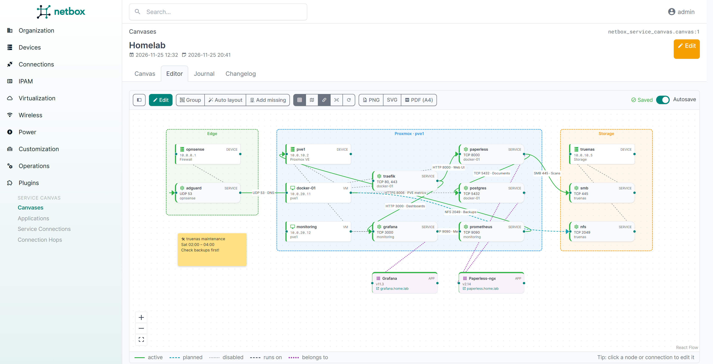

# Editor Guide

Open a canvas and click its **Editor** tab. The editor has three areas: the **sidebar** on the left, the **toolbar**
at the top and the **canvas** in the middle. Clicking a node or a connection opens a **panel** on the right.

## Sidebar

- Tabs for **Devices**, **VMs**, **Services** and **Apps**, each with a search field.
- Drag an entry onto the canvas, or click **+** next to it. Objects already on the canvas are marked.
- **Create new** at the bottom:
  - **Device** and **VM** open the NetBox form in a new tab, because NetBox needs site, role and type. When you come
    back, the list reloads; search for the new object and drag it in.
  - **Service** creates a NetBox service on a host, optionally with an application
    (see [[Service vs Application]]).
  - **Application** creates an application from existing services.
  - **Note** adds a sticky note.

## Toolbar

| Button | What it does |
|---|---|
| Sidebar icon | Show or hide the sidebar |
| **Edit** / **View only** | Switch between edit mode and view mode (see below) |
| **Group** | Add a group frame. Selected nodes go into it. |
| **Auto layout** | Arrange everything from left to right. Groups stay together. |
| **Add missing** | Add related objects that are not on the canvas yet: services of hosts, hosts of services, VMs of devices, connection peers |
| Grid / map / link icons | Snap to grid, minimap, show or hide the "runs on" lines |
| Fit / reload icons | Show the whole canvas, reload from NetBox |
| **PNG**, **SVG**, **PDF (A4)** | Export, see [[Export]] |
| Search field | Find an object on this canvas by name, host, IP or port. Enter or a click jumps to it and opens its panel; arrow keys move through the hits, Esc clears. |
| **Autosave** | Save layout changes automatically. When it is off, a **Save** button appears. |

## Edit mode and view mode

The button at the top left switches between **Edit** and **View only**. View mode hides all editing controls:
the connection dots, the **Remove** buttons and the create buttons. Your browser remembers the choice for each canvas.

Users without change permission on the canvas always see a grey **View only** badge and cannot switch.

## Nodes

A node is a NetBox object on the canvas: a device, VM, service or application. It shows icon, name and primary IP
or protocol and ports (applications: version and URL). The colour shows the status of the host; services take the
status of their host, because NetBox services have no status of their own.

Click a node to open the **node panel**:

- details and the node's connections on this canvas,
- **Quick edit** for services and applications (applications: also the **icon**),
- **Open in NetBox** and **Edit all fields** (the NetBox form; afterwards you return to the editor),
- **Impact analysis** (see [[Impact Analysis]]),
- **Remove from this canvas**.

## Connections

Lines between nodes come in three kinds:

| Line | Meaning | Stored as |
|---|---|---|
| Solid green | Active connection | Service connection |
| Dashed cyan | Planned connection | Service connection |
| Dotted grey | Disabled connection | Service connection |
| Grey dashed, thin | Runs on: service on its host, VM on its device | The service's host / the VM's *Device* field |
| Dotted purple | Service belongs to application | The application's services |

Arrows show the direction; the label shows protocol, port and data. Proxy connections are drawn a bit thicker.

**Drawing a line:** drag from the dot on the right of a node onto another node. A dialog asks what you mean:

- **Data flow** creates a service connection. The port is taken from the target service.
- **Runs on** (only between a service and a device or VM) moves the service to that host. The dialog warns if the
  service currently runs elsewhere.

**Click a connection** to edit protocol, port, data, status and direction, to delete it in NetBox, or to add
**hops**: intermediate stations such as a reverse proxy, VLAN, VRF, tunnel, prefix, IP address or interface. Drag
hops to change their order. In the same panel you set the **kind** for the impact analysis (*Uses* or *Proxy*, see
[[Impact Analysis]]).

**Bending and colouring a line** (edit mode): click the line. Small dots appear in the middle of each segment; drag
one to add a bend point. Drag a point to move it, double-click it to remove it. Pick a colour under *Line on this
canvas*; *Auto* uses the status colour again, *Reset shape* removes all bend points. Shape and colour belong to this
canvas only. *Auto layout* straightens all lines but keeps their colours.

## Groups

A group is a coloured frame with a name, for example a rack, a cluster or a VLAN. Double-click the name to rename it,
drag the corners to resize it. Drag a node into the frame to add it. If nodes are selected when you click **Group**,
the frame is drawn around them. Groups exist only on this canvas.

## Notes

Sticky notes for maintenance windows, to-dos or explanations. Double-click to write, change colour and size as you
like. Notes are saved with the layout and exist only on this canvas.

## Saving

Positions, groups and notes are saved automatically when **Autosave** is on. Only what changed is written, so moving
nodes does not flood the NetBox change log. Positions are rounded to the grid (10 px unless configured otherwise).

Everything else, such as services, applications and connections, is written to NetBox right away when you confirm a
dialog.

## Remove vs. delete

| Action | Effect |
|---|---|
| **Remove** (button above a selected node), the **Del** key, or **Remove from this canvas** in the panel | Removes the node from **this canvas only**. The object stays in NetBox. |
| **Edit all fields** → **Delete** in NetBox | Deletes the object in NetBox. It disappears from every canvas, and its connections are deleted too. |
