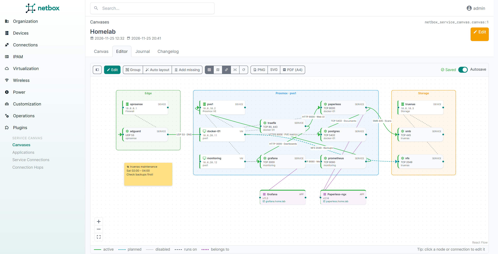

# NetBox Service Canvas Wiki

**NetBox Service Canvas** is a plugin for NetBox 4.5. It shows on an interactive canvas which services run where, how
they talk to each other and what breaks if a host fails. The canvas is built from NetBox data.

## Pages

| Page | What you'll learn |
|---|---|
| [[Getting Started]] | Build a first canvas step by step with a small homelab example |
| [[Service vs Application]] | The difference between the two, and when you need which |
| [[Editor Guide]] | Sidebar, toolbar, nodes, connections, groups, notes, saving, removing and deleting |
| [[Impact Analysis]] | What the colours mean, how it is computed and where its limits are |
| [[Export]] | PNG, SVG and the printable A4 PDF |
| [[API]] | REST API and GraphQL |
| [[FAQ]] | Common questions and troubleshooting |

Installation is described in the
[README](https://github.com/Jasper-Claus/netbox-service-canvas#installation). The editor follows your NetBox
language: English by default, German if NetBox is set to German.
