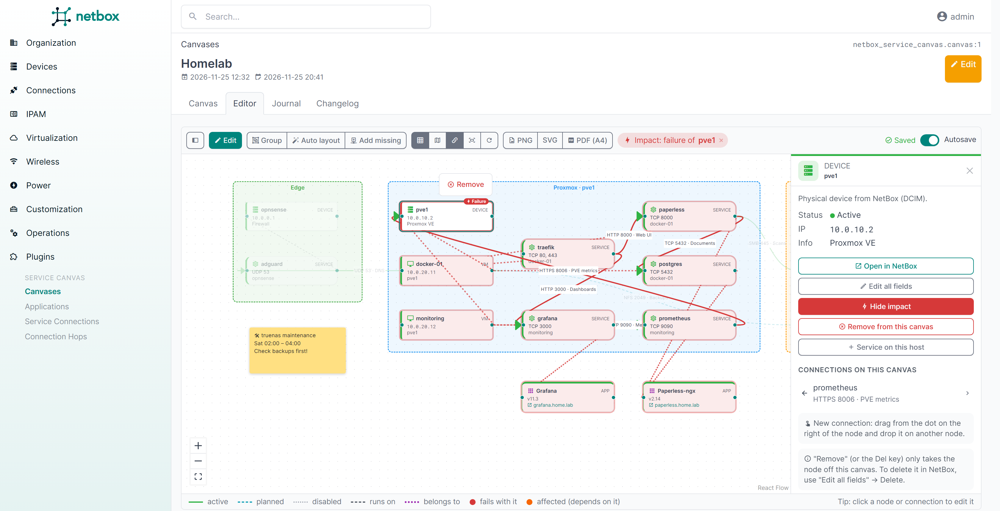

# Impact Analysis

*What breaks if this host goes down?*

## How to start it

1. Click a node: a device, VM, service or application.
2. In the panel on the right, click **Impact analysis**.
3. Everything that is not affected fades out. The toolbar shows *Impact: failure of …*. Click × there to end the
   analysis.

## What the colours mean

| Colour | Meaning |
|---|---|
| Red | **Fails with it.** The object itself and everything that cannot run without it. |
| Orange | **Affected.** Objects that still run, but depend on something that failed. |
| Grey | Not affected. |

## How it is computed

The analysis only uses relations that are documented in NetBox and drawn on the canvas.

**Red** follows the "runs on" and "belongs to" lines:

- a failed device takes down the VMs whose *Device* field points to it,
- a failed device or VM takes down the services running on it,
- a failed service takes down every application it belongs to.

**Orange** follows the connections, against their direction: if A sends data to B and B has failed, A is affected.
This continues step by step: if A → B → C and C fails, both B and A are marked. Bidirectional connections count in
both directions. Disabled connections are ignored; planned ones count.

## Limits

- Only objects and lines on the **current canvas** are analysed. Click **Add missing** first for a complete picture.
- A VM fails with a device only if the VM's **Device** field in NetBox points to that device. A VM that only belongs to
  a cluster is not marked, because NetBox does not know which cluster member it runs on.
- Redundancy is not modelled. If a service is reachable over two paths, it is still marked as affected when one of
  them fails.
- Power, network cabling and switches are not considered. The canvas shows the service layer, not the physical
  infrastructure; for that, NetBox's own cable traces or topology plugins are better suited.
