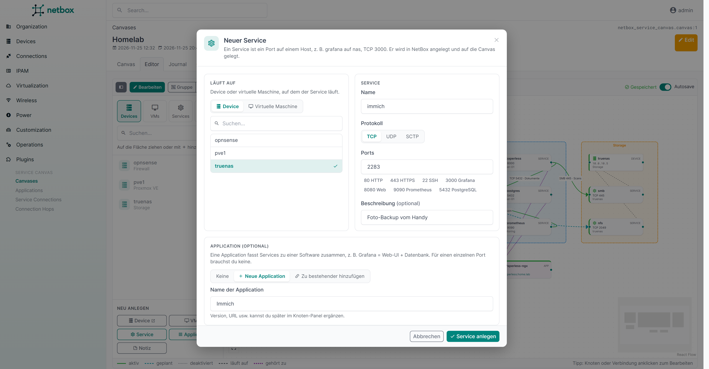

# Service vs. Application

The short version:

| | **Service** | **Application** |
|---|---|---|
| Answers | *Where* does something listen? | *What* is it? |
| Is | One port/protocol on **one** host | The software as a whole |
| Example | `grafana · TCP 3000 · on monitoring` | **Grafana** (web UI service + database service) |
| Comes from | NetBox core (`ipam.Service`) | This plugin |
| Has | Protocol, ports, host | Status, version, URL, its services |

## Do I need both?

- **Simple one-port app** (e.g. AdGuard on UDP 53): a **service** is enough.
- **Software made of several parts** (e.g. Paperless = web UI + Postgres + Redis, maybe on different hosts): create
  one **application** and attach all its services. On the canvas it appears as one node, linked to its services by
  dotted purple "gehört zu" (belongs to) lines.

## In the editor

The **"Neuer Service"** dialog has an *Application (optional)* section:

- **"Keine"** creates just the service.
- **"Neue Application"** creates the application in the same step.
- **"Zu bestehender hinzufügen"** attaches the service to an existing application.

## Connections

A **Service Connection** ("A talks to B") can start or end at a service, device, VM or application. Use services
when you know the port. Use hosts or applications when you only care about the big picture.
